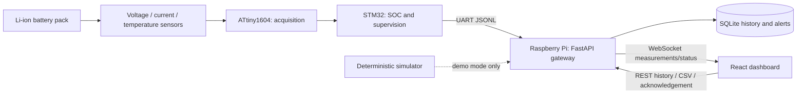

# Architecture

## Responsibilities

STM32 performs all real SOC estimation and supervisory decisions. `Packet.soc` and `battery_status` are copied unchanged to `Measurement`. The gateway adds UTC reception time, source, a database ID when stored and a display operating mode if omitted. It does not estimate runtime in live mode. Runtime is displayed only when the firmware supplies a validated nonnegative value and telemetry is fresh.

The simulator is a separate producer, selected once at startup. The live producer never calls it. SQLite records include `source`; every history query is constrained to one source. A nonpersisted demo uses a separate in-memory event database and never saves simulated measurements to SQLite. Persisted live latest values can be shown after restart, but remain stale until a new valid UART message arrives.

## Concurrency and failure handling

One Uvicorn process runs a producer task and a status-monitor task. UART byte reads run in a worker thread with a bounded timeout. Framing retains partial lines across reads, rejects lines exceeding the configured byte bound, and discards their remainder until newline. The parser rejects bad UTF-8, malformed JSON, missing/unknown fields, wrong types, inconsistent mode, nonfinite numbers and implausible ranges. Invalid packets do not refresh the last-successful-reception timer.

Opening the port is not proof of valid telemetry. Connection status requires a fresh accepted packet and, in hardware mode, an open serial port. An unplug closes the connection; the reader retries at the configured interval. A monotonic clock drives staleness independently of wall-clock adjustments. The browser also checks UTC sample age, WebSocket status, backend health and source/mode consistency; it never manufactures data when disconnected. The last measurement and timestamp remain available.

Each WebSocket receives the current status and latest known measurement, then new measurement events and one-second status events. Per-client send timeouts disconnect stalled clients. The UI reconnects every two seconds and polls backend status every five seconds. The chart buffer is a session-local rolling window, capped at 3,600 records. For higher input rates, only the newest 3,600 samples are retained in that buffer; stored history remains available separately.

SQLite uses WAL mode and parameterized values. Database operations are small and serialized on the application event loop. This design targets a single low-rate battery telemetry stream; a much higher sampling rate would need batched database writes, retention/downsampling and bounded ingest queues. History/CSV queries are bounded to 10,000 records. Disk failures do not switch the input to simulation; operational logs and stale status should be investigated.

## Alert semantics

- Hardware/simulator status: named conditions are critical, generic `WARNING` is warning. `NORMAL` resolves earlier battery events when a fresh packet arrives.
- Configured thresholds: optional, warning-level gateway notifications prefixed `THRESHOLD_`; no default cell chemistry assumptions.
- Communication failure: gateway-generated critical event after the stale timeout, prefixed `GATEWAY_` to distinguish it from firmware status.
- Repeated active conditions create one event. Recovery sets `resolved_at`; later recurrence creates a new event.
- Acknowledgement updates only `acknowledged` in the event store. It does not change active status, UART state or battery protection.
- Unresolved battery faults survive restart and loss of communication until fresh telemetry reports recovery. Acknowledgement also survives restart for persisted events.

The `source` and description distinguish simulator, STM32 and gateway events. In demo mode the UI never represents the STM32 as connected. `NORMAL` is a reported battery condition, not a claim that a protection circuit is active.

## Deployment boundary

FastAPI serves the compiled Vite assets and API from one origin. The application neither configures public hosting nor exposes any control mechanism. Local-network clients can acknowledge dashboard events; add authentication and TLS at a reverse proxy before use on an untrusted network. Run exactly one backend worker. Environment configuration and static build files are read at process startup.
