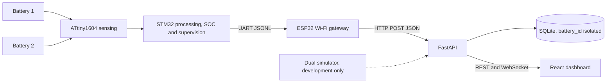

# Dual battery architecture

The STM32 supplies processed voltage, current, temperature, SOC, operating mode and battery status. The gateway validates and stores each battery independently, adds a UTC receive timestamp when the sender omits one, and never calculates SOC. ESP32 device connectivity is separate from each battery's telemetry freshness. A partial batch updates only the battery IDs included; a missing battery becomes stale without interrupting its peer.

The ESP32 sends JSON to `POST /api/ingest`. Payloads require a device ID and one or two unique battery IDs. The batch can include an ISO 8601 timestamp; without one, FastAPI records receive time. Bad IDs, duplicate IDs, unknown keys, invalid types and out-of-range values are rejected. Configure an optional bearer token with `INGEST_TOKEN` before using an untrusted local network.

The SQLite migration adds `battery_id` and `device_id` to existing measurements and assigns pre-migration single-battery records to `BATTERY_1`. Alert records gain a nullable battery ID; old gateway level events remain unassigned. Query history and alerts with an explicit battery ID to preserve separation. The simulator is selected only by `MODE=demo`, tagged `source=demo`, and cannot enter hardware history unless `PERSIST_DEMO=true` is explicitly enabled.

WebSocket measurement events include `battery_id`; status frames include ESP32 connection and per-battery freshness. The browser retains independent buffers and renders old values as stale when either the server or browser freshness check expires. No value is manufactured to fill gaps.

Physical wiring, UART framing, baud and pin mapping are not inferred by this project. Configure those in the ESP32 example only after checking the exact STM32 and ESP32 boards. Verify voltage levels, common ground, pin directions and isolation against their specifications before connecting.
